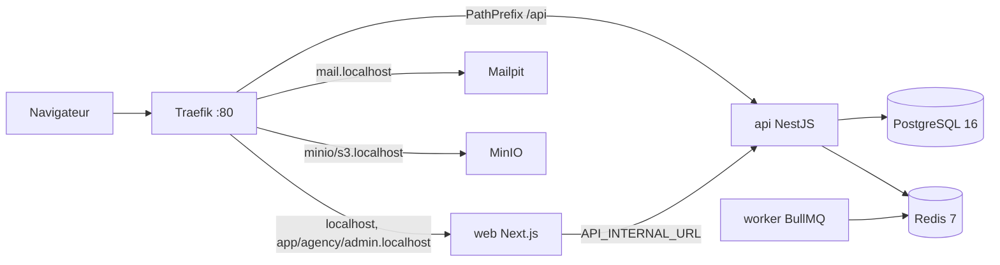

# DriveTN

Plateforme SaaS multi-tenant de location de voitures pour le marché tunisien.

- **Aucun paiement en ligne** : le client réserve sans payer et règle directement l'agence. Les paiements et cautions sont uniquement **déclarés** par l'agence dans son portail.
- **Trois portails** servis par une seule application Next.js : client, agence et administration.
- **Montants en millimes** (entiers), dates stockées en UTC et affichées en `Africa/Tunis`.

> Le nom `DriveTN` est configurable via la variable `APP_NAME`.

## Sommaire

- [Démarrage rapide](#démarrage-rapide)
- [URLs locales](#urls-locales)
- [Mode développement](#mode-développement)
- [Commandes utiles](#commandes-utiles)
- [Variables d'environnement](#variables-denvironnement)
- [Architecture](#architecture)
- [Qualité et tests](#qualité-et-tests)
- [Choix techniques notables](#choix-techniques-notables)
- [Avancement](#avancement)

## Démarrage rapide

Prérequis : **Docker** avec **Compose v2** (Docker Desktop sous Windows/macOS). Rien d'autre n'est nécessaire.

```bash
cp .env.example .env        # PowerShell : Copy-Item .env.example .env
docker compose up --build
```

Au démarrage, l'API applique les migrations Prisma (`prisma migrate deploy`) puis exécute le seed idempotent. `minio-init` crée les buckets S3. Tous les services exposent un healthcheck : `docker compose ps` doit les afficher `healthy`.

**Comptes de démo** : ils seront créés par le seed à partir de la phase 3 (authentification) : `admin@demo.tn`, `agency@demo.tn`, `customer@demo.tn`.

## URLs locales

| Service                                  | URL                                      |
| ---------------------------------------- | ---------------------------------------- |
| Portail client                           | http://localhost et http://app.localhost |
| Portail agence                           | http://agency.localhost                  |
| Portail admin                            | http://admin.localhost                   |
| API (santé)                              | http://localhost/api/v1/health           |
| Documentation OpenAPI                    | http://localhost/api/docs                |
| Mailpit (e-mails de dev)                 | http://mail.localhost                    |
| Console MinIO                            | http://minio.localhost                   |
| Endpoint S3                              | http://s3.localhost                      |
| Tableau de bord Traefik (dev uniquement) | http://traefik.localhost                 |

L'API est servie sous `/api` **sur chaque sous-domaine** (même origine), ce qui évite le CORS et simplifie les cookies httpOnly.

**Résolution de `*.localhost`** : Chrome, Edge et Firefox résolvent automatiquement les sous-domaines de `localhost`. Pour d'autres outils (curl, certains navigateurs), ajoutez au fichier hosts (`C:\Windows\System32\drivers\etc\hosts` ou `/etc/hosts`) :

```
127.0.0.1 app.localhost agency.localhost admin.localhost mail.localhost minio.localhost s3.localhost traefik.localhost
```

Avec curl, vous pouvez aussi forcer l'en-tête : `curl -H "Host: agency.localhost" http://localhost/`.

**Port 80 déjà utilisé** (IIS, WSL, autre serveur web...) : définissez `HTTP_PORT=8088` dans `.env`, puis utilisez `http://agency.localhost:8088`, etc.

## Mode développement

Hot-reload de l'API, du worker et du front, sources montées en volume, PostgreSQL et Redis exposés sur `127.0.0.1` :

```bash
make dev
# sans make :
docker compose -f docker-compose.yml -f docker-compose.dev.yml up --build --renew-anon-volumes
```

`--renew-anon-volumes` recrée les volumes `node_modules` des conteneurs quand les dépendances changent. Sous Windows et macOS, la détection des changements utilise le polling (les événements fichiers ne traversent pas les montages).

Développement hors Docker (Node 20.17+ ou 22, pnpm 9) :

```bash
pnpm install
pnpm codegen                          # build de @drivetn/types + client Prisma
pnpm --filter @drivetn/api dev        # nécessite PostgreSQL et Redis (DATABASE_URL, REDIS_URL)
pnpm --filter @drivetn/web dev
```

## Commandes utiles

| `make`           | Équivalent sans make                             | Rôle                                       |
| ---------------- | ------------------------------------------------ | ------------------------------------------ |
| `make up`        | `docker compose up --build -d`                   | Démarre toute la pile en arrière-plan      |
| `make dev`       | voir ci-dessus                                   | Pile de développement avec hot-reload      |
| `make down`      | `docker compose down --remove-orphans`           | Arrête la pile (données conservées)        |
| `make logs`      | `docker compose logs -f --tail=200`              | Logs de tous les services                  |
| `make ps`        | `docker compose ps`                              | État et santé des services                 |
| `make seed`      | `docker compose exec api node dist/seed/seed.js` | Rejoue le seed (idempotent)                |
| `make reset`     | `docker compose down --volumes` puis `make up`   | **Efface toutes les données** et redémarre |
| `make test`      | `pnpm codegen && pnpm test`                      | Tests unitaires et d'intégration           |
| `make lint`      | `pnpm lint && pnpm format:check`                 | ESLint et Prettier                         |
| `make typecheck` | `pnpm typecheck`                                 | Vérification TypeScript                    |
| `make check`     | `pnpm check`                                     | Tout ce que lance la CI                    |

`make help` liste toutes les cibles.

## Variables d'environnement

Toutes les variables sont documentées dans [`.env.example`](.env.example). Les principales :

| Variable                                 | Rôle                                           | Défaut                               |
| ---------------------------------------- | ---------------------------------------------- | ------------------------------------ |
| `APP_NAME`                               | Nom affiché de la plateforme                   | `DriveTN`                            |
| `APP_DOMAIN`                             | Domaine racine des portails                    | `localhost`                          |
| `APP_TIMEZONE`                           | Fuseau d'affichage                             | `Africa/Tunis`                       |
| `HTTP_PORT`                              | Port HTTP publié par Traefik                   | `80`                                 |
| `POSTGRES_PASSWORD`                      | Mot de passe PostgreSQL                        | **obligatoire**                      |
| `REDIS_PASSWORD`                         | Mot de passe Redis                             | **obligatoire**                      |
| `MINIO_ROOT_PASSWORD`                    | Mot de passe MinIO (8 caractères minimum)      | **obligatoire**                      |
| `S3_BUCKET_PUBLIC` / `S3_BUCKET_PRIVATE` | Buckets photos / documents d'identité          | `drivetn-public` / `drivetn-private` |
| `SWAGGER_ENABLED`                        | Active `/api/docs`                             | `true`                               |
| `CORS_ORIGINS`                           | Origines CORS autorisées (vide = même origine) | vide                                 |
| `SEED_ON_START`                          | Exécute le seed au démarrage de l'API          | `true`                               |

L'API et le front valident leur configuration avec Zod au démarrage et refusent de démarrer si une variable est invalide.

## Architecture

```
apps/
  api/        NestJS : API REST /api/v1, Swagger, Prisma, Redis, worker BullMQ
  web/        Next.js 15 (App Router) : les 3 portails, sélectionnés par nom d'hôte
packages/
  types/      Schémas Zod et types partagés front/back
  config/     tsconfig, ESLint (flat config), Prettier
docker/       Dockerfiles multi-stage, configuration Traefik, init MinIO
```



- **Sélection du portail** : le middleware Next.js lit l'en-tête `Host` et réécrit la requête vers le segment interne (`/client`, `/agency`, `/admin`). Un portail n'est donc pas accessible depuis le sous-domaine d'un autre.
- **API** : préfixe `/api`, versionnement par URI (`/api/v1/...`), erreurs normalisées `{ code, message, details }`, Helmet, `trust proxy` pour Traefik.
- **Santé** : `GET /api/v1/health` vérifie PostgreSQL, Redis et le battement du worker. Le statut vaut `ok`, `degraded` (worker arrêté) ou `error` (HTTP 503, dépendance critique indisponible).
- **Worker** : même image que l'API, point d'entrée `dist/worker.js`. Il exécute la file BullMQ `maintenance` (job planifié de battement). Les files métier (OTP, rappels, expirations) arriveront dans les phases suivantes.
- **Images** : multi-stage, finales en `node:20-alpine`, utilisateur non-root `node`. L'image API ne contient que `dist/`, le schéma Prisma et les dépendances de production (`pnpm deploy --prod`).
- **Données** : volumes nommés `pgdata`, `redisdata` et `miniodata`.

## Qualité et tests

```bash
pnpm check     # codegen + lint + format + typecheck + tests
```

- TypeScript strict partout (`noUncheckedIndexedAccess`, aucun `any`), ESLint `strictTypeChecked`, `no-console` interdit.
- Tests avec **Vitest** : schémas partagés, configuration, filtre d'erreurs, service et contrôleur de santé, test d'intégration HTTP de l'API (supertest), seed, résolution des portails.
- **Husky** : `lint-staged` avant chaque commit, **Commitlint** (Conventional Commits, ex. `feat(api): ...`) sur le message.
- **CI GitHub Actions** ([`.github/workflows/ci.yml`](.github/workflows/ci.yml)) : lint, format, typecheck, tests, puis build des images Docker et smoke test de la pile complète.

## Choix techniques notables

- **Image MinIO** : MinIO ne publie plus d'images sur Docker Hub ni sur Quay. La pile utilise par défaut `cgr.dev/chainguard/minio` (MinIO compilé depuis les sources, maintenu par Chainguard). Elle est remplaçable via `MINIO_IMAGE`.
- **Pas de Turborepo** : les scripts `pnpm -r` / `--filter` suffisent à cette échelle.
- **`@drivetn/types` compilé en CommonJS** : il est consommé tel quel par NestJS (CommonJS) et par Next.js. Lancez `pnpm codegen` après avoir modifié ce paquet ou le schéma Prisma.
- **`@swc/core` figé en 1.15.x** (utilisé uniquement par Vitest côté API) : la 1.16 échoue au chargement de son binaire natif sur certains postes Windows.
- **Paramètres plateforme** : le modèle `PlatformSetting` stocke la TVA (19 %), le timbre fiscal (1 DT) et la commission par défaut. Les taux sont en points de base, les montants en millimes.

## Avancement

| Phase  | Contenu                                                                          | État     |
| ------ | -------------------------------------------------------------------------------- | -------- |
| 1      | Fondations : monorepo, Docker Compose, CI, page Hello, `/api/v1/health`          | Terminée |
| 2      | Design system, thèmes clair/sombre, RTL, layouts des 3 portails                  | À venir  |
| 3      | Authentification, OTP, rôles, seed (gouvernorats, aéroports, comptes de démo)    | À venir  |
| 4 à 10 | Flotte, recherche, réservation, opérations agence, admin, finitions, déploiement | À venir  |

Le guide de déploiement sur VPS (Traefik + HTTPS Let's Encrypt + sauvegardes PostgreSQL) sera rédigé en phase 10.
